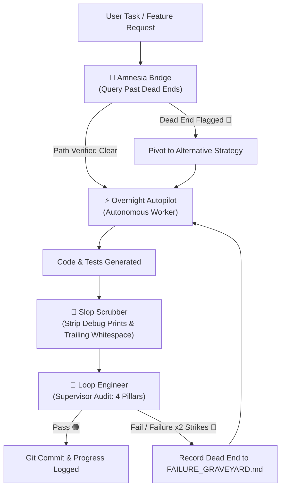

# 🤖 Agent Skills for Antigravity & AI Coding Assistants

A curated collection of production-grade **Agent Skills** designed for autonomous development workflows in **Google Antigravity**, Claude Code, and agentic IDE environments.

---

## 📦 Included Skills Suite

| Skill | Description | Triggers / Keywords |
|---|---|---|
| [🧐 **loop-engineer**](./loop-engineer) | **Human-Proxy Trajectory Auditor & Supervisor**. Acts as your surrogate Senior Tech Lead to rigorously audit agent diffs, verify intent, detect fake tests / AI slop, and prevent circular loops. | `"loop engineer"`, `"check agent's work"`, `"are we on the right track"`, `"audit trajectory"` |
| [⚡ **overnight-autopilot**](./overnight-autopilot) | **Autonomous Unattended Execution Engine**. Operates under zero-interruption rules to execute long-running tasks overnight, maintaining progress in `AUTOPILOT_PROGRESS.md` and committing atomic milestones. | `"overnight"`, `"autopilot"`, `"work all night"`, `"unattended"`, `"don't ask permission"` |
| [🧠 **amnesia-bridge**](./amnesia-bridge) | **Negative Knowledge Ledger & Anti-Thrashing Protocol**. Persists dead-end approaches in `.agents/FAILURE_GRAVEYARD.md` to prevent agents from repeating past errors after context compaction. | `"remember failure"`, `"anti-thrashing"`, `"record dead end"`, `"check approach"` |
| [🧹 **slop-scrubber**](./slop-scrubber) | **Code Hygiene & AI Cruft Sanitizer**. Automatically purges debugging prints, `console.log`s, forgotten breakpoints, silent exception suppressions (`except: pass`), and trailing whitespace before commits. | `"clean slop"`, `"scrub code"`, `"pre-commit sanitize"`, `"verify clean"` |

---

## 🔄 The Complete Autonomous Agent Loop

All 4 skills orchestrate together into a reliable, self-healing autonomous pipeline:



---

## 🚀 Installation

### Option 1: One-Click Global Install

Clone the repository and run all installer scripts to enable these skills in both Antigravity and Claude Code:

```bash
git clone https://github.com/MYMISERABLEMIND17/agent-skills.git
cd agent-skills

# Run all installers
./loop-engineer/install.sh
./overnight-autopilot/install.sh
./amnesia-bridge/install.sh
./slop-scrubber/install.sh
```

This installs global CLI commands into `~/.local/bin/`:
- `loop-engineer`: Audit current trajectory and diffs.
- `autopilot`: Initialize or resume overnight loops.
- `amnesia-bridge`: Query or record dead ends.
- `slop-scrubber`: Scan or clean AI slop from code.

### Option 2: Project-Level Installation (Current Workspace)

To activate skills only within a specific project repository:

```bash
cd /path/to/your/project
mkdir -p .agents/skills
cp -r /path/to/agent-skills/* .agents/skills/
```

---

## 🛠️ Detailed Skill Documentation

- [🧐 Loop Engineer Documentation](./loop-engineer/README.md)
- [⚡ Overnight Autopilot Documentation](./overnight-autopilot/README.md)
- [🧠 Amnesia Bridge Documentation](./amnesia-bridge/README.md)
- [🧹 Slop Scrubber Documentation](./slop-scrubber/README.md)
- [📋 Supervisor Audit & Remediation Log](./SUPERVISOR_AUDIT.md)

---

## 📄 License

MIT License. Free to use, adapt, and distribute.
