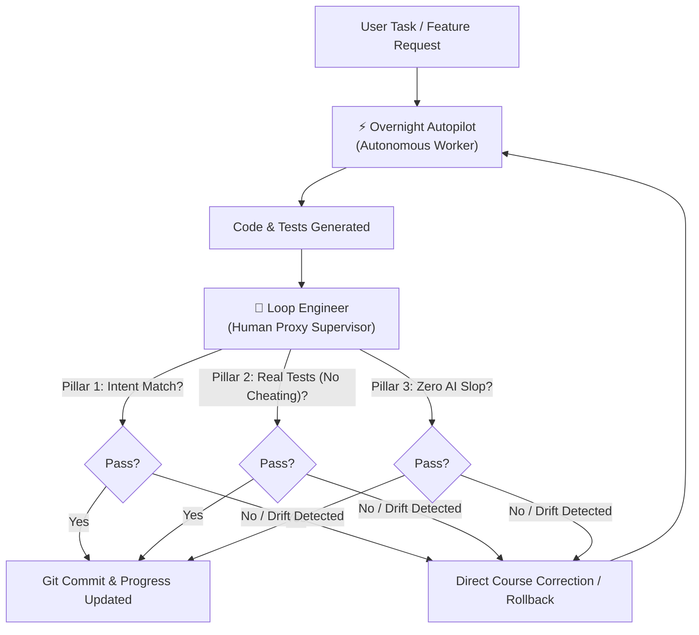

# 🤖 Agent Skills for Antigravity & AI Coding Assistants

A curated collection of production-grade **Agent Skills** designed for autonomous development workflows in **Google Antigravity**, Claude Code, and agentic IDE environments.

---

## 📦 Included Skills

| Skill | Description | Triggers / Keywords |
|---|---|---|
| [🧐 **loop-engineer**](./loop-engineer) | **Human-Proxy Trajectory Auditor & Supervisor**. Acts as your surrogate Senior Tech Lead to rigorously audit agent diffs, verify intent, detect fake tests / AI slop, and prevent circular loops. | `"loop engineer"`, `"check agent's work"`, `"are we on the right track"`, `"audit trajectory"`, `"human proxy"` |
| [⚡ **overnight-autopilot**](./overnight-autopilot) | **Autonomous Unattended Execution Engine**. Operates under zero-interruption rules to execute long-running tasks overnight, maintaining progress in `AUTOPILOT_PROGRESS.md` and committing atomic milestones. | `"overnight"`, `"autopilot"`, `"work all night"`, `"unattended"`, `"don't ask permission"` |

---

## 🔄 The Dual-Agent Pattern: Worker + Supervisor

These two skills complement each other to form a resilient autonomous loop:



---

## 🚀 Installation

### Option 1: Global Installation (All Projects)

To make these skills available across all workspaces in Antigravity:

```bash
# Clone the repository
git clone https://github.com/MYMISERABLEMIND17/agent-skills.git

# Install skills to global config
mkdir -p ~/.gemini/config/skills
cp -r agent-skills/loop-engineer ~/.gemini/config/skills/
cp -r agent-skills/overnight-autopilot ~/.gemini/config/skills/
```

Or run the bundled installers in each directory:

```bash
cd agent-skills/loop-engineer && ./install.sh
cd ../overnight-autopilot && ./install.sh
```

### Option 2: Project-Level Installation (Current Workspace)

To activate skills only within a specific project repository:

```bash
cd /path/to/your/project
mkdir -p .agents/skills
cp -r /path/to/agent-skills/loop-engineer .agents/skills/
cp -r /path/to/agent-skills/overnight-autopilot .agents/skills/
```

---

## 🛠️ Detailed Skill Documentation

- [🧐 Loop Engineer Documentation](./loop-engineer/README.md)
- [⚡ Overnight Autopilot Documentation](./overnight-autopilot/README.md)

---

## 📄 License

MIT License. Free to use, adapt, and distribute.
