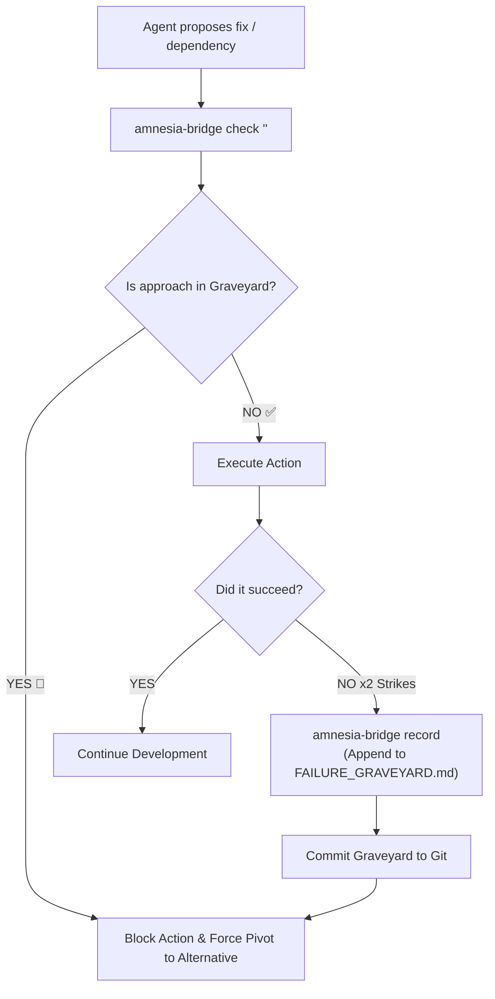

# 🧠 Amnesia Bridge (Negative Knowledge & Anti-Thrashing Ledger)

**The persistent memory shield that prevents AI coding agents from repeating past failures, dead-end dependencies, and circular loops.**

---

## 🎯 The Problem

When autonomous agents run long tasks (e.g. overnight or multi-turn sessions), they inevitably hit the **Context Compaction Wall**:
1. **Amnesia**: The agent's conversation history is summarized or truncated.
2. **Circular Thrashing**: The agent "forgets" that 45 minutes ago it already tried installing an incompatible library, only to have the build fail. It tries the exact same command again.
3. **Wasted Hours & Tokens**: The agent exhausts hours repeating known dead ends instead of exploring genuinely new solutions.

**Amnesia Bridge solves this by externalizing failure memory into a durable, version-controlled ledger: `.agents/FAILURE_GRAVEYARD.md`.**

---

## 🔄 How It Works



---

## 🚀 Quick Start

### Installation

Run the installation script:
```bash
./install.sh
```
This installs:
- The skill into Antigravity (`~/.gemini/config/skills/amnesia-bridge`)
- The skill into Claude Code (`~/.claude/skills/amnesia-bridge`)
- The global CLI `amnesia-bridge` into `~/.local/bin/amnesia-bridge`

---

## 🛠️ CLI Usage

### 1. Initialize the Graveyard
```bash
amnesia-bridge init
```

### 2. Check Candidate Action Before Running It
```bash
amnesia-bridge check "npm install node-sass"
```
*If a matching dead end exists, the command returns non-zero exit code with the exact reason it previously failed and the prohibited rule.*

### 3. Record a New Dead End (Two-Strike Rule)
```bash
amnesia-bridge record \
  --category "Dependency" \
  --attempt "Installing node-sass with Node 22" \
  --error "Node-gyp rebuild failed: Unsupported runtime version" \
  --rule "Never install node-sass; use sass-embedded instead"
```

### 4. Export Active Constraints for Prompt Injection
```bash
amnesia-bridge export-context
```

### 5. Inspect Statistics
```bash
amnesia-bridge summary
```

---

## 🤝 Pairing with Other Agent Skills

- **Pair with `overnight-autopilot`**: Keeps unattended overnight runs on track by recording dead ends immediately instead of getting stuck in infinite trial-and-error loops.
- **Pair with `loop-engineer`**: During supervisor audits, `loop-engineer` flags whether the agent ignored recorded graveyard rules.

---

## 📄 License
MIT License.
