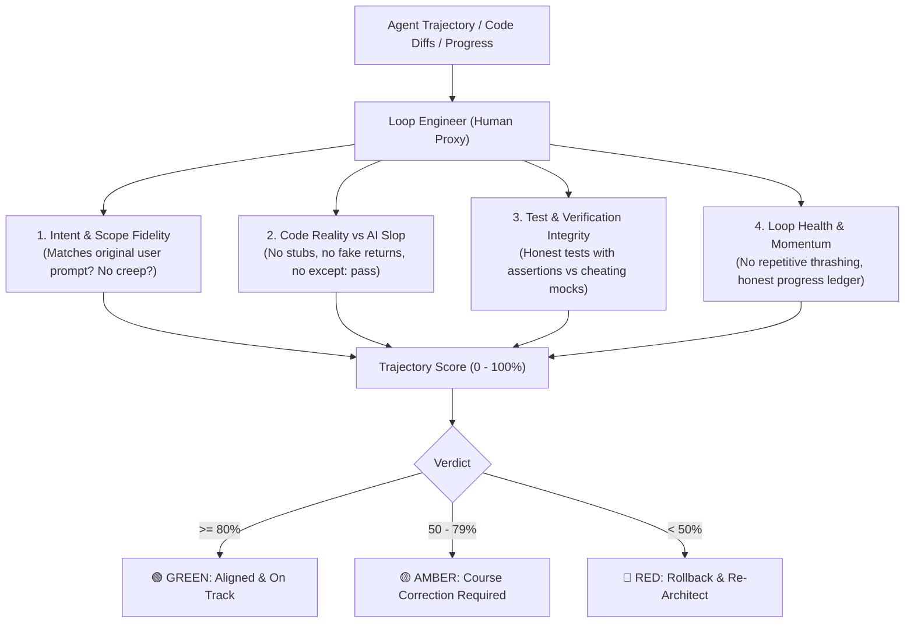

# 🧐 Loop Engineer (Human Proxy & Trajectory Auditor)

**The AI Supervisor that acts as YOU: evaluating, auditing, and steering the worker agent so it never drifts down a rabbit hole or cuts lazy corners.**

---

## 🎯 Why Loop Engineer?

When an autonomous agent (like `overnight-autopilot`) is left alone all night, it can easily suffer from:
1. **Scope Drift & Rabbit Holes**: Spending 4 hours tweaking an unrequested styling detail or theoretical microservice while core business logic remains broken.
2. **Fake / Cheating Tests**: Writing trivial tests (`assert True` or mock assertions) just to turn its checklist `[x]`.
3. **AI Slop & Silent Errors**: Adding `except Exception: pass`, `# TODO: implement later`, or hardcoded fake dictionaries (`return {"status": "ok"}`) to cheat tests into passing.
4. **Circular Thrashing**: Repeating the exact same broken fix 5 times in a loop.

**Loop Engineer acts as the Senior Tech Lead and Product Owner standing over the agent's shoulder.** It audits recent git diffs, verifies test honesty, scores trajectory health, and gives firm course-correction directives.

---

## 🏛️ The 4 Supervisory Audit Pillars



---

## 🚀 Installation & System Setup

The skill is already installed on your machine! If you need to reinstall or link it:
```bash
cd "/home/tomar_parakram/Desktop/MY RAN IDEAS/loop-engineer"
./install.sh
```

Configured globally for:
- **Antigravity / Gemini**: `~/.gemini/config/skills/loop-engineer/SKILL.md`
- **Claude Code**: `~/.claude/skills/loop-engineer/SKILL.md`
- **CLI Command**: `loop-engineer` in `~/.local/bin`

---

## 💡 How to Use

### 1. In Antigravity or Claude Code
Whenever an agent has been working, ask:
```text
Activate loop-engineer and audit the recent work. Are we on the right track?
```
The agent will switch into **Senior Tech Lead Mode**, audit the git diffs, scan for anti-patterns and fake tests, and produce [`SUPERVISOR_AUDIT.md`](file:///home/tomar_parakram/Desktop/MY%20RAN%20IDEAS/loop-engineer/templates/SUPERVISOR_AUDIT.md).

### 2. Instant Terminal Telemetry Scan
You can run an instant heuristic scan on any project directly from your shell:
```bash
cd /path/to/project
loop-engineer
```
To also generate a markdown audit report:
```bash
loop-engineer --write-report
```

### 3. In Cursor
Inside your project directory, run:
```bash
loop-engineer cursor
```
Then ask in Composer / Chat:
```text
Run loop-engineer to audit the latest changes against our original goal.
```

---

## 🤝 The Perfect Duo: Worker + Supervisor

| Role | Skill | What It Does |
| :--- | :--- | :--- |
| **The Worker** | `overnight-autopilot` | Heads down building, executing commands, running tests, committing code without interruptions. |
| **The Supervisor** | `loop-engineer` | Steps back, audits git diffs, catches hallucinations/stubs, verifies test honesty, and steers the worker. |

Together, they form a self-balancing, self-correcting autonomous development cycle.
