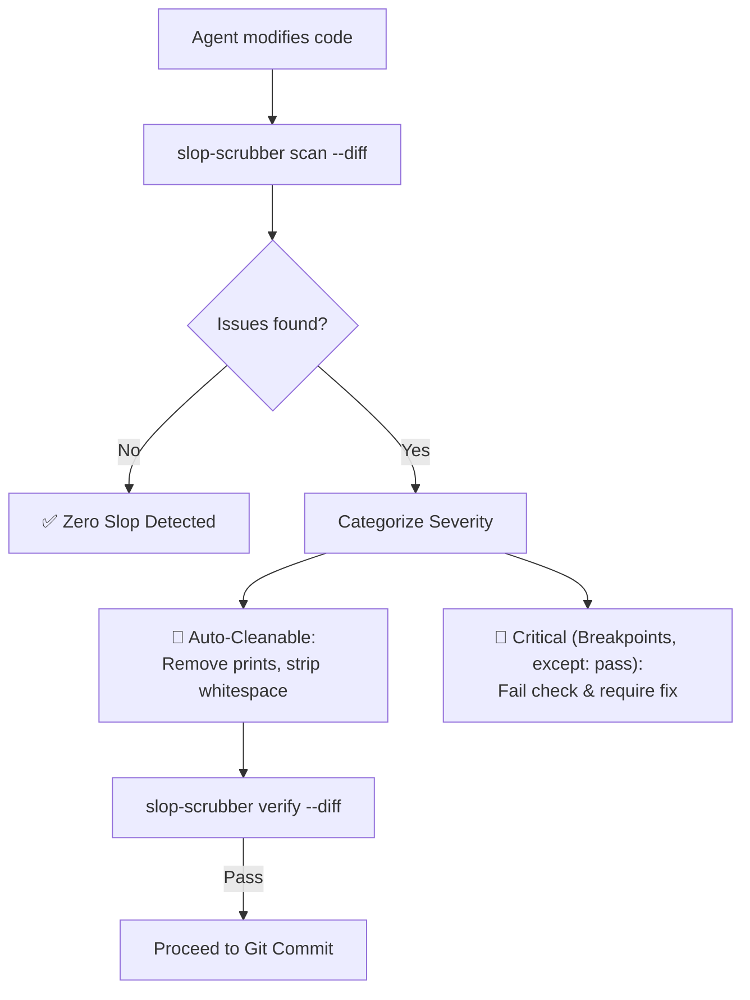

# 🧹 Slop Scrubber (Code Hygiene & AI Cruft Sanitizer)

**Automated pre-commit sanitation that purges debugging statements, silent exception suppressions, breakpoints, and formatting anomalies left behind by AI coding agents.**

---

## 🎯 The Problem

When AI coding agents iterate through tasks, they write code fast—but leave behind messy footprints:
1. **Debug statements**: `console.log("here 1")`, `print("DEBUG:", val)`, `fmt.Println("test")`.
2. **Breakpoints**: Forgotten `debugger;` or `breakpoint()` calls that crash in headless CI environments.
3. **Silent error suppression**: `except Exception: pass` added to pass unit tests without actually handling the edge case.
4. **Formatting artifacts**: Trailing whitespace, inconsistent line endings, and missing final newlines.

**Slop Scrubber scans the agent's work, removes removable cruft, and ensures your pull requests look clean and professional.**

---

## 🔄 Sanitation Flow



---

## 🚀 Quick Start

### Installation

```bash
./install.sh
```
This installs:
- The skill into Antigravity (`~/.gemini/config/skills/slop-scrubber`)
- The skill into Claude Code (`~/.claude/skills/slop-scrubber`)
- The global CLI `slop-scrubber` into `~/.local/bin/slop-scrubber`

---

## 🛠️ CLI Usage

### 1. Scan Modified Files for Slop (Non-destructive)
```bash
slop-scrubber scan
```

### 2. Auto-Clean Scaffolding & Trailing Whitespace
```bash
slop-scrubber clean
```

### 3. Verify Clean State (for CI or Pre-Commit Hooks)
```bash
slop-scrubber verify
```
*Exits with code `0` if clean, or code `1` if critical slop remains.*

### 4. Scan a Specific File
```bash
slop-scrubber scan -f src/api/client.py
```

---

## 🤝 The Agent Skills Ecosystem

- **`overnight-autopilot`**: Runs through long autonomous tasks.
- **`amnesia-bridge`**: Prevents repeating past failures.
- **`slop-scrubber`**: Sanitizes the code before committing.
- **`loop-engineer`**: Audits the overall trajectory and test truthfulness.

---

## 📄 License
MIT License.
